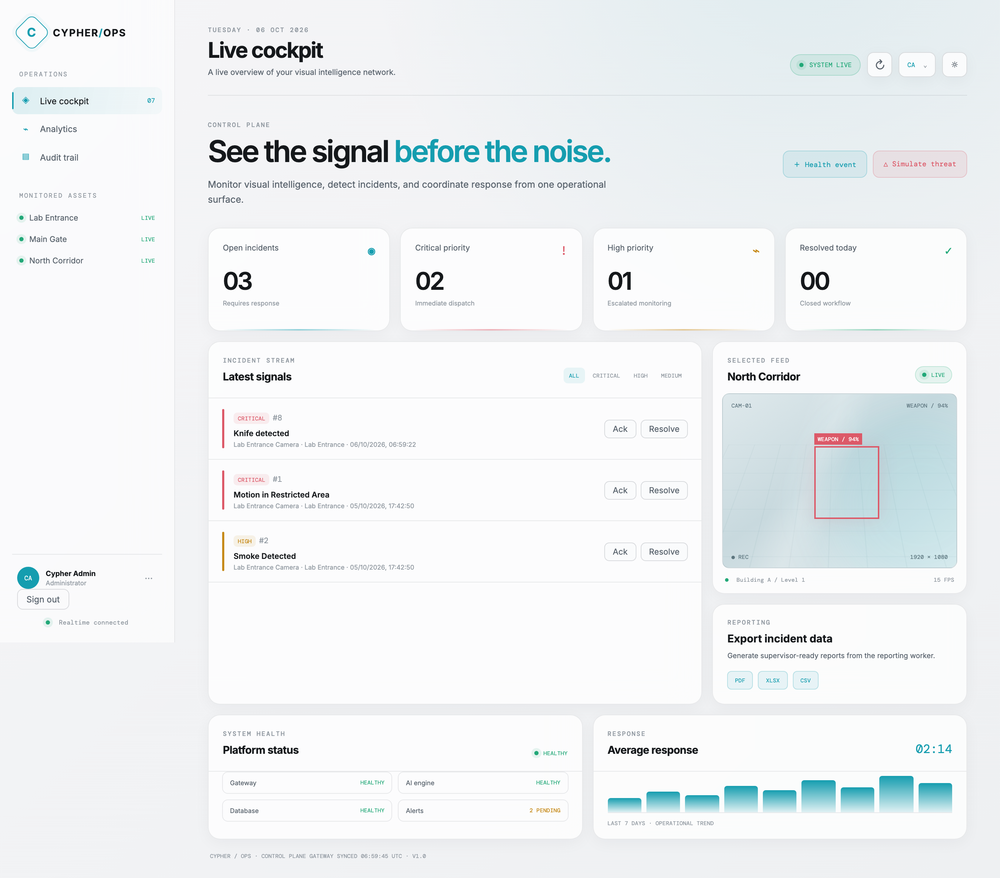

# ai — CYPHER AI engine

Computer-vision incident detection. Runs YOLO, reports findings to the Spring
Boot gateway, which owns the database. This service holds no persistent state.

## Verified result

The six-class detector drives the live incident pipeline:

```
image  ->  YOLO  ->  POST /api/incidents/ingest  ->  CRITICAL incident in the cockpit
```



## Model

| | |
|---|---|
| Architecture | YOLOv8s, fine-tuned from COCO weights |
| Dataset | 18,642 train / 2,656 validation / 385 held-out comparison images |
| Classes | `knife`, `pistol`, `person`, `fire`, `smoke`, `lying` |
| Input | 640 px |
| Training | 40-epoch five-class stage + 20-epoch six-class fine-tune, Apple MPS |
| Checkpoint | `.dsh-scratch/training/runs/cypher-v3-6class/weights/best.pt` |

**Held-out comparison metrics** (385 images, 416 weapon boxes):

| Metric | Value |
|---|---|
| mAP@50 | **0.8898** |
| mAP@50-95 | **0.6502** |
| Mean precision | 0.8652 |
| Mean recall | 0.8088 |

| Class | Precision | Recall | AP@50 |
|---|---|---|---|
| knife | 0.8432 | 0.8426 | 0.9116 |
| pistol | 0.8873 | 0.7750 | 0.8680 |

Across all six classes, the merged validation split reaches **mAP@50 0.7435**
and **mAP@50–95 0.5149**. Full model card, per-class tables, PR/F1 curves,
confusion matrices, limitations and the team’s engineering contribution are in
[`evidence/README.md`](evidence/README.md).

**Honest limitations.** The weapon comparison set and merged validation set
measure different things. `lying` has only 15 validation boxes, and upstream
`GUN` annotation boundaries depress pistol recall on the merged split. The model
has not yet been validated on a large, site-specific feed from the actual
cameras. See the full limitations in the evidence model card.

## Endpoints

| Method | Path | Purpose |
|---|---|---|
| GET | `/health` | liveness, loaded weights, gateway reachability |
| POST | `/detect` | run detection on an uploaded image, **no side effects** |
| POST | `/monitor/frame` | detect **and raise incidents** for what it finds |
| POST | `/monitor/stream` | bounded run over a video file or camera index |

## Terminal pipeline (no browser needed)

`ai/cli.py` runs the trained model on one image, a video, the Mac webcam, or the
ESP32-CAM's MJPEG stream, prints every decision, and posts incidents to the
gateway so they appear in the cockpit.

```bash
cd ~/CYPHER/.dsh-scratch/work

# safe test: detect, never post
~/CYPHER/.dsh-scratch/ml/bin/python ai/cli.py --source photo.jpg --dry-run

# photo -> real incident in the cockpit
~/CYPHER/.dsh-scratch/ml/bin/python ai/cli.py --source photo.jpg --camera-id 1

# live Mac webcam
~/CYPHER/.dsh-scratch/ml/bin/python ai/cli.py --source 0 --seconds 30

# ESP32-CAM (Mac connected to CYPHER-CAM)
~/CYPHER/.dsh-scratch/ml/bin/python ai/cli.py \
  --source http://192.168.4.1:81/stream --seconds 60
```

It defaults to the six-class model (`knife, pistol, person, fire, smoke,
lying`). Useful flags: `--weights`, `--conf`, `--imgsz`, `--confirm`,
`--cooldown`, `--stride`, `--save <dir>` for annotated frames, and `--gateway`.

The gateway (`http://localhost:8081`) must be running; the CLI talks to it
directly, so the FastAPI service is not needed for terminal use.

## Run

```bash
python -m venv .venv && . .venv/bin/activate
pip install -r requirements.txt
uvicorn ai.app.main:app --host 0.0.0.0 --port 5000
```

Configuration is entirely environment-driven — `GATEWAY_URL`, `YOLO_WEIGHTS`,
`YOLO_CONFIDENCE`, `CYPHER_CAMERA_ID`, `INCIDENT_COOLDOWN`. See `app/config.py`.

## Design notes

**Severity is decided by the gateway, not here.** This service reports *what* it
saw; `IncidentService.deriveSeverity` decides that a weapon is CRITICAL
regardless of confidence. A new detector therefore cannot invent its own
priority vocabulary.

**One incident per object class per frame.** A single image often yields several
overlapping boxes for the same object; reporting each one raised five identical
incidents from one photograph. The best-confidence detection per class wins.

**Cooldown.** A 30 fps stream would otherwise raise 30 incidents a second. The
same class on the same camera is suppressed for `INCIDENT_COOLDOWN` seconds.

## Training

The reproducible dataset and training scripts are in
[`training/`](training/README.md). Raw datasets and checkpoints stay outside Git
because they are large:

1. `fetch_datasets.py` — fetch the Hugging Face sources
2. `to_yolo.py` — normalise, remap and split all sources into one dataset
3. `train.py` — two-stage YOLOv8s transfer learning
4. `evaluate.py` — fixed comparison metrics, matrices and PR/F1/P/R curves

The fixed 385-image test split is copied untouched, so old and new checkpoints
are scored on the same images.

## Next

- Add more site-specific fall/lying footage and clean inconsistent `GUN` boxes.
- Evaluate the detector through the ESP32-CAM under real lighting and motion.
- Add a tracked-byte-stream option and a durable event queue before treating
  browser delivery as a production message bus.
