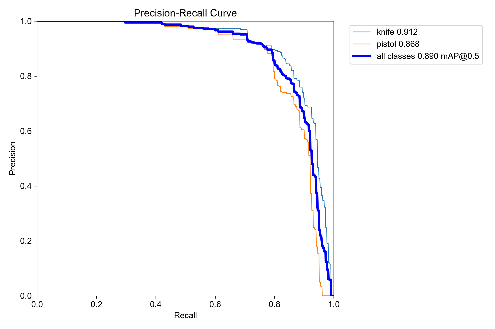
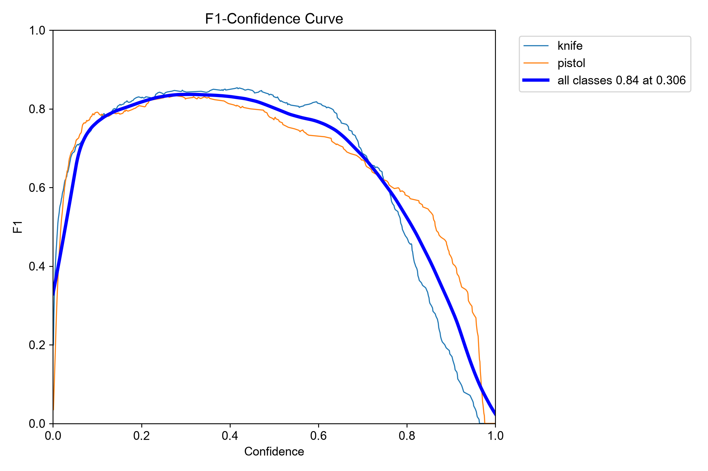
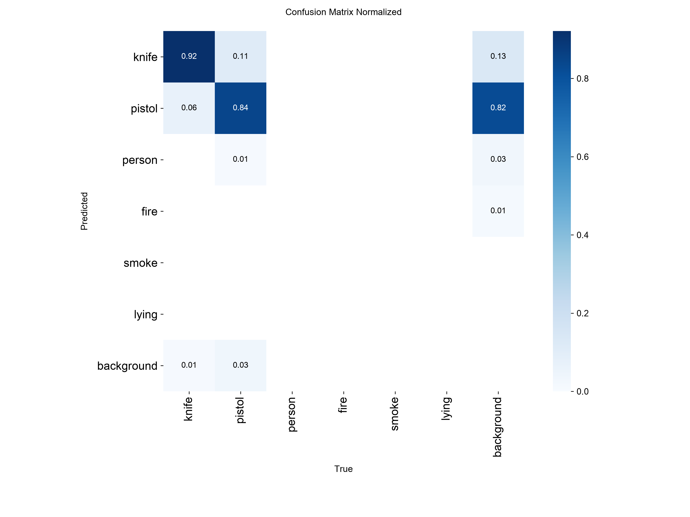
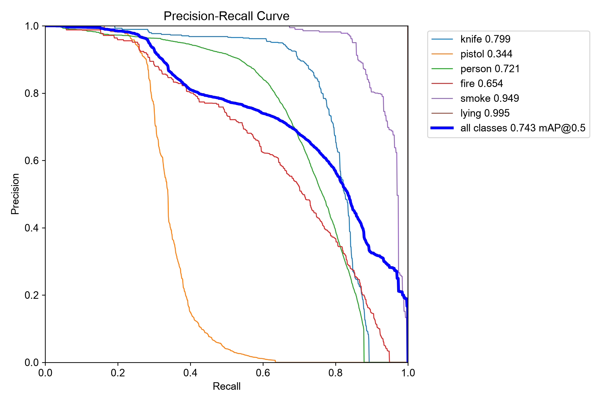
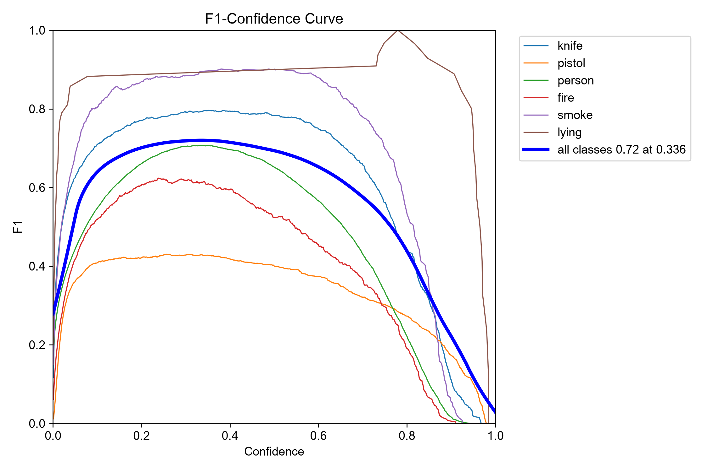
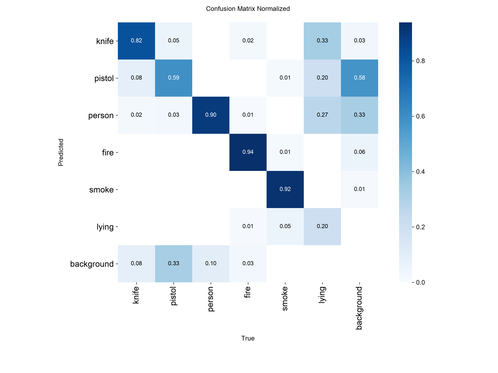

# CYPHER detector — evaluation evidence

This is the model card and evaluation record for the checkpoint used by the
cockpit demo. The numbers below were measured after training; they are not
examples cherry-picked from the training set.

## At a glance

| | |
|---|---|
| Task | Multi-class object detection |
| Model | YOLOv8s, fine-tuned from COCO weights through Ultralytics |
| Input | 640 × 640 RGB |
| Classes | `knife`, `pistol`, `person`, `fire`, `smoke`, `lying` |
| Dataset | 18,642 train / 2,656 validation images / 385 held-out comparison images |
| Training | 40-epoch five-class stage, then 20-epoch six-class fine-tune |
| Hardware | Apple M4 Pro, MPS |
| Checkpoint | `cypher-v3-6class/weights/best.pt` |
| SHA-256 | `0928a402efc1ca85eb9eab1e2909fd113cccdb3e0fe61fed507e327f98460438` |

The 385-image comparison set comes from the original guns-knives dataset and
was never used for training. It measures both the old prototype and the current
checkpoint on exactly the same images, so the improvement is a like-for-like
comparison rather than a new number on an easier split.

## Headline results

### Held-out comparison set

385 images, 416 weapon boxes (`knife` and `pistol`).

| Metric | Old 2-class model | Current 6-class model |
|---|---:|---:|
| mAP@50 | 0.5886 | **0.8898** |
| mAP@50–95 | 0.4029 | **0.6502** |
| Mean precision | 0.751 | **0.8652** |
| Mean recall | 0.509 | **0.8088** |

| Class | Precision | Recall | AP@50 | AP@50–95 |
|---|---:|---:|---:|---:|
| knife | 0.8432 | **0.8426** | 0.9116 | 0.6169 |
| pistol | 0.8873 | 0.7750 | 0.8680 | 0.6835 |

The largest practical change is knife recall: it rose from 0.345 in the old
model to 0.843. In other words, the detector now finds roughly eight of every
ten labelled knives on the same test set instead of about three.

### Full merged validation set

2,656 images and approximately 13.3k labelled boxes across all six classes.

| Metric | Value |
|---|---:|
| mAP@50 | **0.7435** |
| mAP@50–95 | **0.5149** |
| Mean precision | 0.8291 |
| Mean recall | 0.6759 |

| Class | Precision | Recall | AP@50 | AP@50–95 |
|---|---:|---:|---:|---:|
| knife | 0.8549 | 0.7402 | 0.7988 | 0.5358 |
| pistol | 0.8676 | 0.2846 | 0.3438 | 0.2663 |
| person | 0.8068 | 0.6289 | 0.7209 | 0.3934 |
| fire | 0.7024 | 0.5446 | 0.6538 | 0.3611 |
| smoke | 0.9360 | 0.8571 | 0.9487 | 0.5861 |
| lying | 0.8068 | 1.0000 | 0.9950 | 0.9470 |

## Curves and confusion matrices

Precision–recall curves show the trade-off between finding more incidents and
raising fewer false alarms. The confusion matrices show which classes are being
mixed up. These are generated by Ultralytics at the measured operating point.

### Held-out comparison set







### Merged six-class validation set







The raw confusion matrices are also stored beside these files. Old-model
evidence is preserved under [`legacy-v1/`](legacy-v1/) rather than overwritten.

## What algorithm are we using?

CYPHER uses **YOLOv8s**, a single-stage convolutional object detector. One
forward pass predicts object boxes, class probabilities and confidence scores
at the same time. Ultralytics then applies non-maximum suppression to remove
overlapping proposals for the same object. This design is fast enough for a
live camera while still producing multiple classes in one frame.

Detection alone is not the whole algorithm. The event pipeline is:

1. **YOLOv8s inference** at 640 px with a confidence threshold.
2. **Class-aware de-duplication**: keep only the highest-confidence box for
   each class in a frame.
3. **Temporal confirmation**: require the same class on eight consecutive
   frames before raising an incident from a stream.
4. **Cooldown**: suppress repeated alerts for the same class and camera for
   90 seconds.
5. **Gateway-owned severity rules**: weapons and fire are always CRITICAL;
   smoke/fall/lying are HIGH at 85% or above and MEDIUM otherwise; other
   classes use confidence bands.
6. **Transactional ingest**: PostgreSQL writes the inference job, source
   detection, incident and alert in one transaction.
7. **Post-commit delivery**: a WebSocket update reaches the cockpit only after
   the database transaction commits.

Rules 2–4 came from a measured failure, not guesswork: during a 1,282-frame
webcam run with no pistol present, the detector intermittently labelled frames
as `pistol` at 35–55% confidence. A single frame is therefore insufficient
evidence for a real incident.

## Our contribution beyond “the model produced boxes”

The pretrained architecture is not presented as original work. The team’s
contribution is the system that turns a general detector into a usable CYPHER
pipeline:

- **Dataset engineering:** merged and normalised five differently structured
  sources, mapped `GUN → pistol`, `flame → fire` and `laying → lying`, corrected
  a skewed person split with deterministic filename hashing, and preserved a
  fixed 385-image test set for fair comparison.
- **Measured model improvement:** replaced a YOLOv8n/416 px prototype with a
  YOLOv8s/640 px six-class model trained in two stages; mAP@50 improved from
  0.589 to 0.890 on the same held-out images.
- **False-positive engineering:** class-aware de-duplication, temporal
  confirmation and cooldown were added from observed webcam failure data.
- **Safety semantics:** severity is owned by the Spring Boot gateway, not the
  AI process, so swapping a model cannot silently change incident priority.
- **Reliable event handling:** the inference job, detection, incident and alert
  commit atomically; WebSocket broadcast happens only after commit.
- **Operational visibility:** Live trace exposes the runtime decisions; audit
  logs record incident changes; RBAC prevents unauthorized actions.
- **End-to-end integration:** the same trained model can be driven by the
  terminal CLI, the FastAPI engine, or an ESP32-CAM MJPEG stream, and every path
  uses the same gateway incident contract.

## Honest limitations

- The 0.890 mAP@50 score is on the fixed weapon comparison set. The broader
  six-class evidence is the 0.744 mAP@50 merged-validation result.
- `lying` has only 15 validation boxes, so its 0.995 AP@50 is encouraging but
  not statistically strong. More real fall/lying footage is required.
- Pistol validation recall is low (0.285) because some upstream `GUN`
  annotations cover different visible regions than this class definition. The
  held-out pistol recall is 0.775, but this mismatch should be cleaned before a
  production claim.
- The model has not yet been validated on a large, site-specific dataset from
  the actual campus cameras. Webcam and ESP32-CAM footage will expose lighting,
  motion-blur and small-object failures that datasets do not fully represent.
- The demo runs the AI process on the Mac; AWS currently hosts the gateway and
  cockpit. Moving inference to a GPU server is an operational step, not a
  claim made by these metrics.

## Reproduce

The datasets and trained weights live outside Git because they are large. On
the training machine:

```bash
cd ~/CYPHER/.dsh-scratch/work
~/CYPHER/.dsh-scratch/ml/bin/python ai/training/evaluate.py \
  ~/CYPHER/.dsh-scratch/training/runs/cypher-v3-6class/weights/best.pt \
  ai/evidence
```

This writes `metrics.json`, `metrics.md`, both confusion matrices and the PR,
F1, precision and recall curves into this directory.
